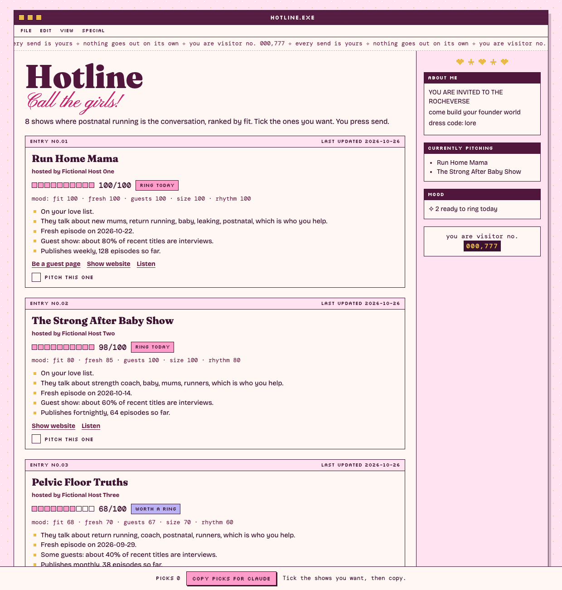
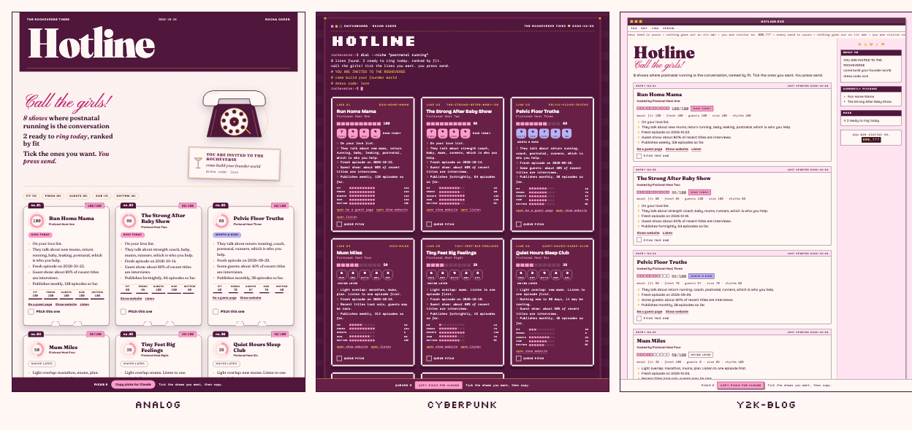

# Podcast Outreach Engine

*Rocha Coded. Free tools from the Rocheverse.*

Claude finds the podcasts your people listen to, scores them for you, drafts the pitch in your words, and you press send.

**Every send is yours.** Nothing goes out on its own. No auto-send, no scraped inboxes, no DMs fired off while you sleep.
You get a ranked shortlist, a pitch per show that sounds like you, and a call log that tells you who is due a nudge.

<p align="center"></p>

<p align="center"></p>

<p align="center"><sub>Same shortlist, three looks: analog, cyberpunk and y2k blog. Pick yours, or change the colours and fonts and every look follows.</sub></p>

## Start here
Five steps, about ten minutes, and you never have to touch code. This is the Claude Code path. Using the Claude desktop app's Cowork instead? Skip to [Claude Cowork](#claude-cowork), it is even shorter.

 **Open the terminal.** The *terminal* is the app where you type instructions to your computer. On a Mac, open Finder, then Applications > Utilities > Terminal. You will see a small window with a blinking cursor. That is all it is.

 **Check that Python is there.** This asks your computer which version of Python (the language the tool is written in) it has.
   ```sh
   python3 --version
   ```
   You will see something like `Python 3.12.8`. Anything from 3.10 up is perfect.

 **Copy the tool onto your computer.** To *clone* means to download a copy of the tool's folder. This puts it where Claude Code looks for skills (a *skill* is a set of instructions Claude follows).
   ```sh
   git clone https://github.com/RochaStone/podcast-outreach-engine ~/.claude/skills/podcast-outreach-engine
   ```
   You will see `Cloning into ...` and then your cursor comes back. That means it worked.

 **Make a home for your podcast work and open Claude there.** This makes a folder called `podcast-outreach`, steps into it, and starts Claude Code.
   ```sh
   mkdir -p ~/podcast-outreach && cd ~/podcast-outreach && claude
   ```
   You will see Claude Code's welcome screen.

 **Say "get me on podcasts".** Claude introduces the plan and asks you the first of ten questions about you. Answer in your own words. From here, Claude does the rest and tells you what is happening at every step.

<p align="center"></p>

## What you get
- **A guest profile in your words.** Ten questions, one at a time. Who you help, what changes for them, the stories you tell, the topics you refuse. It becomes the brief for every pitch.
- **A shortlist of real shows.** Ranked out of 100 on how well they fit your people, whether they are still publishing, whether they take guests, their staying power and their rhythm. Every score comes with plain reasons.
- **A pitch per show.** Three subject lines, the email, three talking points, a short bio and a follow-up. Built from your own phrases, never a template voice.
- **A call log.** Who you pitched, who replied, who booked, and who is due a gentle nudge today.

This didn't exist, so I built it.

<p align="center"></p>

## Install
It runs on your own computer, in your own folder. You need Python 3.10 or newer (already on most Macs and Linux machines) and an internet connection. Nothing else to install. No account, no server, and no API key (a private password one program uses to talk to another).

| Where you use it | Install it | Start it |
|---|---|---|
| [Claude Code](#claude-code) (recommended) | clone into `~/.claude/skills` | ask "get me on podcasts" |
| [Claude Cowork](#claude-cowork) | upload `podcast-outreach-engine.zip` as a skill | ask for a podcast shortlist in a Cowork task |

Tested end to end in Claude Code on macOS. Cowork runs the same steps inside its own sandbox.

### Claude Code
```sh
git clone https://github.com/RochaStone/podcast-outreach-engine ~/.claude/skills/podcast-outreach-engine
```
Then start Claude Code in the folder you want your podcast work saved in (if you start it anywhere else, Claude uses `~/podcast-outreach/` for you) and say "get me on podcasts". To update later: `git -C ~/.claude/skills/podcast-outreach-engine pull`.

### Claude Cowork
Cowork (the Claude desktop app) runs tasks in a Linux sandbox on your computer that can only reach the folders you give it.
1. Download `podcast-outreach-engine.zip` (a *zip* is one compressed file that holds the whole tool folder) from the [latest release](https://github.com/RochaStone/podcast-outreach-engine/releases/latest).
2. In the Claude desktop app: Customize > Skills, then + > Create skill > Upload a skill, and pick the zip.
3. In Settings > Capabilities, turn on code execution and file creation, and allow network access so it can search podcast directories.
4. Make a folder for this, for example `podcast-outreach` in your home folder. Start a Cowork task, give it access to that folder, and ask: "Build me a podcast shortlist."
5. Your profile, shortlist, pitches and call log are saved in that folder, so they stay on your computer.

If the sandbox can't reach the internet on your setup, use Claude Code instead.

### Optional: a second directory
Search uses the Apple Podcasts directory, which needs no key. For wider results, get free keys from [Podcast Index](https://api.podcastindex.org/signup). Then copy `.env.example` to a file called `.env` in your podcast folder and paste them in. A `.env` file is a small private settings file that holds keys. It stays on your computer and is never shared.

<p align="center"></p>

## The five steps
Claude picks up where you left off every time, from the files in your folder.

1. **Guest profile.** Ten questions, one per turn. Saved as `profile/guest-profile.md`. Edit it whenever you like. Claude re-reads it every run.
2. **Discover.** Claude searches the podcast directories with words from your profile, then reads each show's public RSS feed (the public list every podcast publishes of its episodes, the same one podcast apps read): last episode, how often they publish, how many episodes, whether the titles look like interviews, and the show's public website or "be a guest" page when the feed links one. Saved as `shows/shows.json`.
3. **Score.** Every show gets a score out of 100 with reasons. Shows on your love list get a lift. Shows built on a topic you refuse sink. Open `shortlist/shortlist.html`, tick "Pitch this one" on the cards you want, and press "Copy picks for Claude".
4. **Pitch.** One file per show in `pitches/`, written from your profile and the show's own recent episodes. You edit until it sounds like you. If you have a Gmail or Outlook connector, Claude saves it as a draft and tells you so. Otherwise you copy it. Either way, you press send.
5. **Track.** Tell Claude when you've sent it. The call log in `tracker/tracker.md` sets your nudge dates: a first nudge after 7 days, a second 10 days later, then you let it go. Ask "who's due a nudge?" any time. Open `tracker/tracker.html` for the call log page.

<p align="center"></p>

## If it goes wrong (everyone's first time) 
These happen to almost everyone the first time. Each one has a quick fix.

- **"certificate verify failed" or every search fails on a Mac.** Python from python.org sometimes arrives without its security certificates. Open Finder, then Applications > Python 3.x, and double-click `Install Certificates.command` once. Then ask Claude to search again.
- **"command not found: python3" or "command not found: git".** Your Mac needs its developer tools. Type `xcode-select --install` in the terminal and click Install in the window that appears. When it finishes, start again from step 2.
- **Only a handful of shows came back.** Your search words were very specific, which is a good sign about your niche. Tell Claude "try broader words" and it will search again with wider phrases. In Cowork, also check that network access is turned on in Settings > Capabilities.

<p align="center"></p>

## Make it yours
Your pages take their colours, fonts, name and lines from one small `style.json` in your folder. Rocha's look ships as the example (`examples/style.rocha-coded.json`), with a blank `style.example.json` to fill in, and [STYLE.md](STYLE.md) explains every key.
Pick a look with one word in `style.json` (`"motif": "analog"`, `"cyberpunk"` or `"y2k-blog"`), or ask Claude "show me the cyberpunk one". Colours and fonts re-tone every look, so you curate both.
Say "make it mine" and Claude builds yours from your references, your palette and your words.
The same file styles every Rocha Coded tool, so you make it once.

<p align="center"></p>

## What it will never do
- **Send anything.** Not an email, not a DM, not a form. Drafts only. The send button is yours.
- **Scrape emails or DMs.** It never looks up, guesses or stores a host's email address, phone number or social handles. Feed owner emails are skipped and any address found in a show description is removed before saving. You use the show's own public website or guest page.
- **Invent proof.** Numbers, clients and results only come from what you wrote in your profile.
- **Pitch a topic you refuse.** If a show is built on it, Claude tells you and moves on.
- **Phone home.** No analytics, no accounts. It talks to the podcast directories and the shows' public feeds, and that's it.

<p align="center"></p>

## What's inside
| Path | What it is |
|---|---|
| `SKILL.md` | The instructions Claude follows, step by step |
| `discover.py` | Searches Apple Podcasts (and Podcast Index if you add keys), reads public feeds, writes `shows/shows.json` |
| `score.py` | Scores shows against your profile, writes `shortlist/shortlist.json` and the Hotline page |
| `track.py` | Adds pitches, updates statuses, lists who is due a nudge, draws the call log |
| `pitch/PITCH-GUIDE.md` | How every pitch is built, and the quality bar it has to pass |
| `templates/guest-profile.md` | The ten-question profile template |
| `style.example.json`, `STYLE.md` | Your look in one file, and what each key does |
| `engine/` | The shared pieces: feed reading, scoring, tracker, and the pages in three looks (analog, cyberpunk, y2k blog) |
| `scripts/make-readme-images.py` | Makes every picture in this README from the tool itself |
| `examples/` | A fictional guest, a scored shortlist, a sample pitch and a sample call log, plus every page in all three looks in `examples/looks/`. Nothing in it is real |
| `tests/` | Unit tests and one live directory search. Run `python3 -m unittest` |

Python standard library only. No packages to install.

<p align="center"></p>

## Licence
MIT. Copyright (c) 2026 Rochelle Livingstone / Thriving Era Studio. See [LICENSE](LICENSE).

[Sign my guestbook](https://github.com/RochaStone/podcast-outreach-engine/issues)

## Made by Rocha

Rocha \
Brand Alchemist & AI Architect \
Author of *Brand Alchemy in the Thriving Era* \
Creator of [Conscious Founder Operating System](https://founders.thrivingera.com) \
Founder, [Thriving Era Studio](https://thrivingera.com)

I help female founders build their founder world, and I build what they need next. \
Start with the audit: [thrivingera.com/audit](https://thrivingera.com/audit). \
Or book an exploratory call: [calendly.com/rochelle-thrivingera/exploratory-call](https://calendly.com/rochelle-thrivingera/exploratory-call). It is where we decide if we work together.

[Instagram @rocheverse](https://instagram.com/rocheverse) · [Substack](https://rochastone.substack.com) · [LinkedIn](https://www.linkedin.com/in/rochellelivingstonecosmic) · [More free tools](https://thrivingera.com/free) · [All tools on GitHub](https://github.com/RochaStone)
