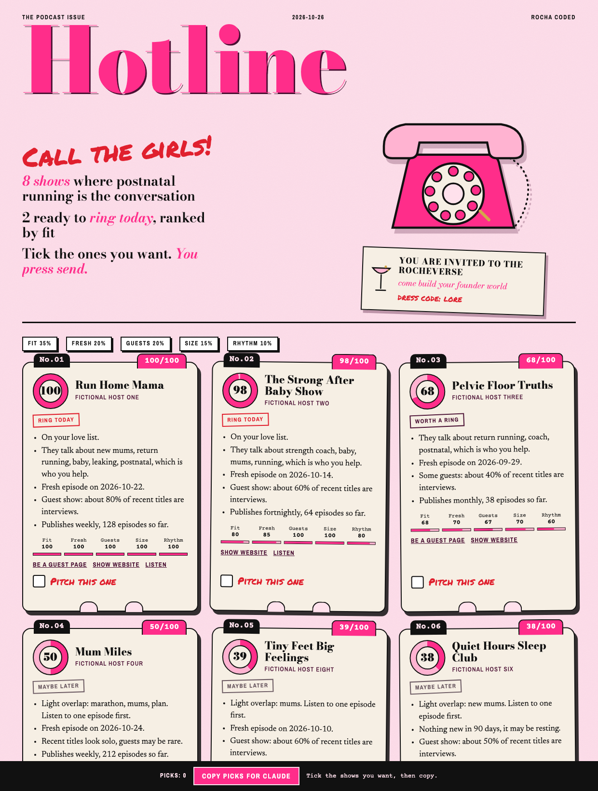

# Podcast Outreach Engine

*Rocha Coded. Free tools from the Rocheverse.*

Claude finds the podcasts your people listen to, scores them for you, drafts the pitch in your words, and you press send.

**Every send is yours.** Nothing goes out on its own. No auto-send, no scraped inboxes, no DMs fired off while you sleep.
You get a ranked shortlist, a pitch per show that sounds like you, and a call log that tells you who is due a nudge.

<p align="center"></p>

## What you get
- **A guest profile in your words.** Ten questions, one at a time. Who you help, what changes for them, the stories you tell, the topics you refuse. It becomes the brief for every pitch.
- **A shortlist of real shows.** Ranked out of 100 on how well they fit your people, whether they are still publishing, whether they take guests, their staying power and their rhythm. Every score comes with plain reasons.
- **A pitch per show.** Three subject lines, the email, three talking points, a short bio and a follow-up. Built from your own phrases, never a template voice.
- **A call log.** Who you pitched, who replied, who booked, and who is due a gentle nudge today.

This didn't exist, so I built it.

## Install
It runs on your own computer, in your own folder. You need Python 3.10 or newer (already on most Macs and Linux machines) and an internet connection. Nothing else to install. No account, no server, no API key.

| Where you use it | Install it | Start it |
|---|---|---|
| [Claude Code](#claude-code) (recommended) | clone into `~/.claude/skills` | ask "get me on podcasts" |
| [Claude Cowork](#claude-cowork) | upload `podcast-outreach-engine.zip` as a skill | ask for a podcast shortlist in a Cowork task |

Tested end to end in Claude Code on macOS. Cowork runs the same steps inside its own sandbox.

### Claude Code
```sh
git clone https://github.com/RochaStone/podcast-outreach-engine ~/.claude/skills/podcast-outreach-engine
```
Then start Claude Code in the folder you want your podcast work saved in (or anywhere, and it will use `~/podcast-outreach/`) and say "get me on podcasts". To update later: `git -C ~/.claude/skills/podcast-outreach-engine pull`.

### Claude Cowork
Cowork (the Claude desktop app) runs tasks in a Linux sandbox on your computer that can only reach the folders you give it.
1. Download `podcast-outreach-engine.zip` from the [latest release](https://github.com/RochaStone/podcast-outreach-engine/releases/latest).
2. In the Claude desktop app: Customize > Skills, then + > Create skill > Upload a skill, and pick the zip.
3. In Settings > Capabilities, turn on code execution and file creation, and allow network access so it can search podcast directories.
4. Make a folder for this, for example `podcast-outreach` in your home folder. Start a Cowork task, give it access to that folder, and ask: "Build me a podcast shortlist."
5. Your profile, shortlist, pitches and call log are saved in that folder, so they stay on your computer.

If the sandbox can't reach the internet on your setup, use Claude Code instead.

### Optional: a second directory
Search uses the Apple Podcasts directory, which needs no key. For wider results, get free keys from [Podcast Index](https://api.podcastindex.org/signup), copy `.env.example` to `.env` in your podcast folder and paste them in. Your `.env` stays on your computer.

## The five steps
Claude picks up where you left off every time, from the files in your folder.

1. **Guest profile.** Ten questions, one per turn. Saved as `profile/guest-profile.md`. Edit it whenever you like. Claude re-reads it every run.
2. **Discover.** Claude searches the podcast directories with words from your profile, then reads each show's public feed: last episode, how often they publish, how many episodes, whether the titles look like interviews, and the show's public website or "be a guest" page when the feed links one. Saved as `shows/shows.json`.
3. **Score.** Every show gets a score out of 100 with reasons. Shows on your love list get a lift. Shows built on a topic you refuse sink. Open `shortlist/shortlist.html`, tick "Pitch this one" on the cards you want, and press "Copy picks for Claude".
4. **Pitch.** One file per show in `pitches/`, written from your profile and the show's own recent episodes. You edit until it sounds like you. If you have a Gmail or Outlook connector, Claude saves it as a draft and tells you so. Otherwise you copy it. Either way, you press send.
5. **Track.** Tell Claude when you've sent it. The call log in `tracker/tracker.md` sets your nudge dates: a first nudge after 7 days, a second 10 days later, then you let it go. Ask "who's due a nudge?" any time. Open `tracker/tracker.html` for the pink call log.

## What it will never do
- **Send anything.** Not an email, not a DM, not a form. Drafts only. The send button is yours.
- **Scrape emails or DMs.** It never looks up, guesses or stores a host's email address, phone number or social handles. Feed owner emails are skipped and any address found in a show description is removed before saving. You use the show's own public website or guest page.
- **Invent proof.** Numbers, clients and results only come from what you wrote in your profile.
- **Pitch a topic you refuse.** If a show is built on it, Claude tells you and moves on.
- **Phone home.** No analytics, no accounts. It talks to the podcast directories and the shows' public feeds, and that's it.

## What's inside
| Path | What it is |
|---|---|
| `SKILL.md` | The instructions Claude follows, step by step |
| `discover.py` | Searches Apple Podcasts (and Podcast Index if you add keys), reads public feeds, writes `shows/shows.json` |
| `score.py` | Scores shows against your profile, writes `shortlist/shortlist.json` and the Hotline page |
| `track.py` | Adds pitches, updates statuses, lists who is due a nudge, draws the call log |
| `pitch/PITCH-GUIDE.md` | How every pitch is built, and the quality bar it has to pass |
| `templates/guest-profile.md` | The ten-question profile template |
| `engine/` | The shared pieces: feed reading, scoring, tracker, the pink pages |
| `examples/` | A fictional guest, a scored shortlist, a sample pitch and a sample call log. Nothing in it is real |
| `tests/` | Unit tests and one live directory search. Run `python3 -m unittest` |

Python standard library only. No packages to install.

## Licence
MIT. Copyright (c) 2026 Rochelle Livingstone / Thriving Era Studio. See [LICENSE](LICENSE).

## Made by Rocha

Rocha \
Brand Alchemist & AI Architect \
Author of *Brand Alchemy in the Thriving Era* \
Creator of [Conscious Founder OS](https://founders.thrivingera.com) \
Founder, [Thriving Era Studio](https://thrivingera.com)

I take female founders AI native in 7 days, and I build what they need next. \
Start with the audit: [thrivingera.com/audit](https://thrivingera.com/audit). \
Or book an exploratory call: [calendly.com/rochelle-thrivingera/exploratory-call](https://calendly.com/rochelle-thrivingera/exploratory-call). It is where we decide if we work together.

[Instagram @rocheverse](https://instagram.com/rocheverse) · [Substack](https://rochastone.substack.com) · [LinkedIn](https://www.linkedin.com/in/rochellelivingstonecosmic) · [More free tools](https://thrivingera.com/free) · [All tools on GitHub](https://github.com/RochaStone)
